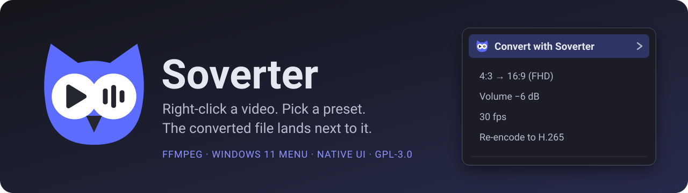
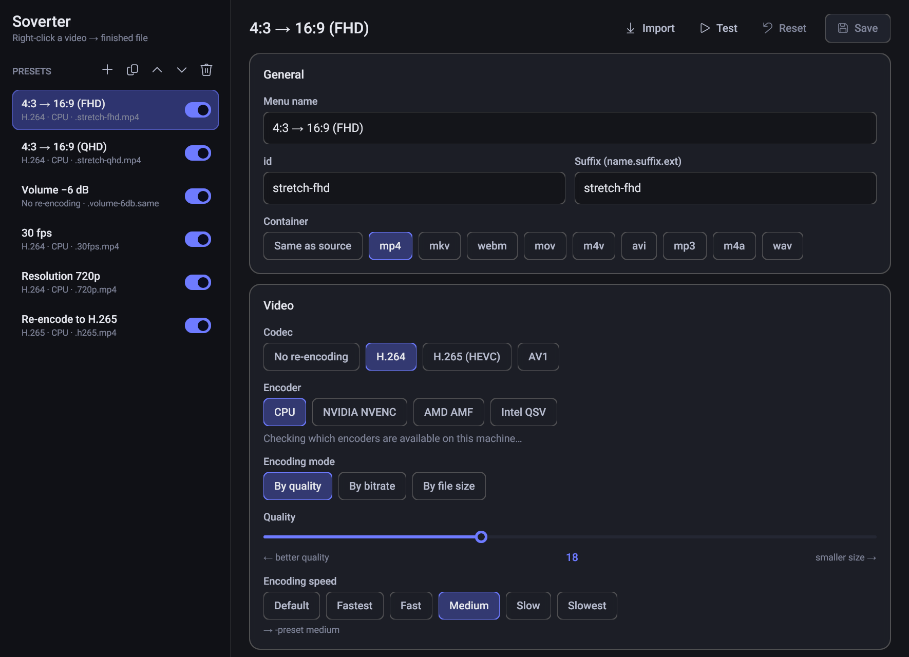
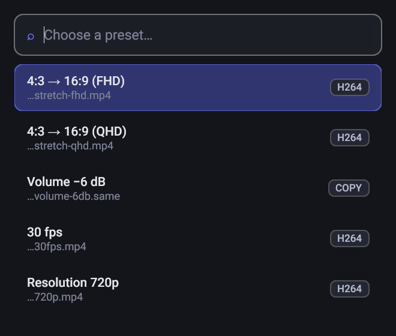
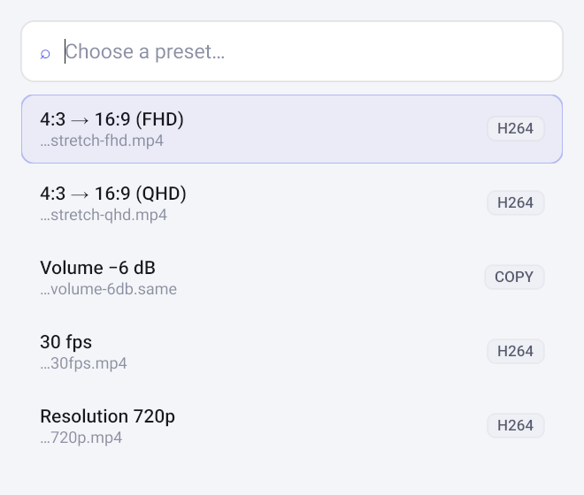

<p align="center">
  
</p>

<p align="center">
  <b>A free, open-source video converter that lives in the Explorer right-click menu.</b><br>
  Pick an ffmpeg preset on any video and the result appears right next to the original.
</p>

<p align="center">
  <a href="https://github.com/feedblackg44/soverter/releases/latest"><b>Download</b></a> ·
  <a href="#install">Install</a> ·
  <a href="#preset-builder">Preset builder</a> ·
  <a href="#building-from-source">Build from source</a>
</p>

<p align="center">
  <a href="https://github.com/feedblackg44/soverter/actions/workflows/ci.yml"></a>
  <a href="https://github.com/feedblackg44/soverter/releases/latest"></a>
  <a href="https://github.com/feedblackg44/soverter/releases"></a>
  
  <a href="LICENSE"></a>
</p>

<table>
  <tr>
    <td width="33%" valign="top">
      <b>Right where you are</b><br>
      One item in the Explorer menu (the new Windows 11 one too) with your presets inside.
      No app to open, no drag and drop into a window.
    </td>
    <td width="33%" valign="top">
      <b>ffmpeg without the syntax</b><br>
      Build a preset from a form: codec, hardware encoder, quality or target file size, scaling, audio.
      Or paste a ready ffmpeg command and import it.
    </td>
    <td width="33%" valign="top">
      <b>Native and private</b><br>
      A small native app, no WebView and no telemetry. Everything runs locally; the result is saved next to the original.
    </td>
  </tr>
</table>

## Screenshots

<p align="center">
  <br>
  <sub>The preset editor: a form instead of ffmpeg flags, with a live command preview.</sub>
</p>

<p align="center">
  
  <br>
  <sub>The preset picker (single-item menu mode), dark and light themes follow Windows.</sub>
</p>

## Requirements

- Windows 10 or 11 (the new Windows 11 context menu needs Windows 11)
- `ffmpeg` and `ffprobe` in `PATH`, not bundled. Use a full build with libx264/libx265 (`winget install Gyan.FFmpeg`, or the "full" GPL build from <https://www.gyan.dev/ffmpeg/builds/>); minimal and LGPL builds lack these encoders

## Install

Download `soverter.exe` from the Releases page and run it. In the editor, click **Windows menu → Install from saved presets**
(or just **Save**); the menu is registered automatically. If you move `soverter.exe` later, press **Save** again (the path to the exe
is stored in the menu registration).

On Windows 11 the item appears in the new context menu (a signed package with an `IExplorerCommand` handler); on Windows 10, or
if the package is unavailable, a classic registry menu is used (on Windows 11 it lives under "Show more options").

## Usage

| Command | Action |
| --- | --- |
| `soverter` / `soverter edit` | preset editor |
| `soverter run <id> <file>...` | apply a preset; progress window with a queue |
| `soverter pick <file>...` | preset picker window |
| `soverter install` / `uninstall [--cert]` | register / remove the menu (and the trusted certificate) |
| `soverter list` | list presets |

The first run creates `%APPDATA%\soverter\presets.toml` with starter presets.

## Preset builder

A preset can be built from a form without knowing ffmpeg syntax: codec (H.264 / H.265 / AV1 / no re-encode), encoder
(CPU / NVIDIA NVENC / AMD AMF / Intel QSV, only those available on this machine), rate mode (quality / bitrate / target file
size), speed, frame size (keep / keep aspect / stretch / fit), fps, audio (copy / AAC / Opus / remove), volume and container.
A live preview of the command is shown at the bottom with a **Copy** button. **Import from an ffmpeg command** parses a ready-made
command and shows what was recognised and what stays raw.

- **Encoder availability** is checked by a trial encode (`-f lavfi color`, 0.1 s) for every hardware encoder, not just by the
  `ffmpeg -encoders` list. The check runs in the background when the editor starts and is cached for a week
  (`%LOCALAPPDATA%\soverter\encoders.json`); **Settings → Re-check encoders** forces it.
- **Target file size:** the bitrate is computed at run time as `size_MB * 8192 * 0.95 / duration - audio` (duration and audio bitrate
  come from ffprobe). CPU H.264/H.265 encode in two passes (logs go to a temp folder and are removed), the rest in one pass;
  hitting the size exactly is not guaranteed for hardware encoders.
- **Legacy presets** (`vf` / `af` / `args` without `[preset.video]` tables) keep working and open in raw-arguments mode; the
  button "Open in the builder (via import)" converts them.

`presets.toml` format (in a structured preset `vf` / `af` / `args` are extra filters and arguments):

```toml
[[preset]]
id = "stretch-fhd"
name = "4:3 → 16:9 (FHD)"
suffix = "stretch-fhd"
ext = "mp4"                # same = the source extension
[preset.video]
codec = "h264"             # copy | h264 | h265 | av1
encoder = "cpu"            # cpu | nvenc | amf | qsv
rate_mode = "quality"      # quality | bitrate | size
quality = 18               # one scale (lower = better); video_bitrate (Mbit/s); target_size_mb
speed = "medium"           # fastest | fast | medium | slow | slowest (or an encoder value such as p5)
scale_mode = "stretch"     # none | keep | stretch | fit
width = 1920
height = 1080
[preset.audio]
mode = "copy"              # copy | aac | opus | remove
bitrate = "192k"
volume_db = -6
```

Flags per encoder family: CPU `-crf N -preset …` (AV1: libsvtav1, `-preset 0..13`); NVENC `-rc vbr -cq N -b:v 0 -preset p1..p7`;
QSV `-global_quality N -preset …`; AMF `-rc cqp -qp_i N -qp_p N [-qp_b N] -quality speed|balanced|quality`. By bitrate: CPU `-b:v NM`;
NVENC `-rc vbr -b:v NM -maxrate 1.5·NM`; AMF `-rc vbr_peak -b:v NM -maxrate 1.5·NM`; QSV `-b:v NM -maxrate 1.5·NM`.
The AMF and QSV flags follow the documentation and have not been verified on hardware.

## Language, scale, menu item name

- **Language and scale.** The interface is English by default; the language (English / Russian) and the scale (100–200%) are
  changed in **Settings** and apply immediately (stored in `[settings]` as `language`, `ui_scale`). The scale can also be changed
  with `Ctrl+=`, `Ctrl+-`, `Ctrl+0` in any window, handy on QHD/4K when Windows scaling can't be raised. The Roboto font is embedded.
- **Menu item name.** By default the Explorer item reads like "Edit with Notepad++": `Convert with Soverter`, or
  `Обработать с помощью Soverter` when the Windows display language is Russian (the app's own language does not matter).
  Change it under **Settings → Explorer menu item name** (`menu_title` in `[settings]`).

## Notes

- `ext = "same"` keeps the source extension.
- The checkbox next to a preset enables or disables it in the menu (`disabled = true` in the file).
- Reorder presets by dragging (the row follows the cursor, a line shows the drop position) or with the ↑/↓ buttons.
- Only one instance runs at a time (a loopback port, `127.0.0.1:47613`, is used for that).
- In "single item" mode the classic menu starts `pick` once per file; the new menu hands all selected files to one process.

## Building from source

Go (see `go.mod`) is enough for the app itself, no C compiler needed:

```powershell
go build -ldflags "-H=windowsgui" -o soverter.exe ./cmd/soverter
go vet ./... ; go test ./...      # the e2e tests need ffmpeg and are skipped without it
```

### The Windows 11 menu package

The menu is a C++ COM library (`shellext/`) shipped as a signed MSIX that is embedded into `soverter.exe`. Building it needs
MinGW-w64 (g++/gcc) in `PATH` and the Windows SDK (`makeappx`, `signtool`; `winget install Microsoft.WindowsSDK.10.0.22621`):

```powershell
.\shellext\package.ps1        # self-signed: creates a certificate in CurrentUser\My on first run
```

The built package (`internal\shellext\assets\soverter.msix`, `.cer`) is **not in git**; `go build` embeds it when present. Rebuild it
after changing `shellext\ctx.cpp` or the manifest. Without the package the app still builds and works; the Windows 11 menu is
unavailable and the classic menu is used.

A self-signed build asks you to trust its certificate once: on the first menu install the app adds the public part to
`LocalMachine\TrustedPeople` (**one UAC prompt**, no developer mode). Remove it with **Windows menu → Remove certificate from trusted**
or `soverter uninstall --cert`. Builds that embed no certificate (officially signed releases) have no such step.

The menu library reads the list of presets from `%APPDATA%\soverter\menu.txt`, so editing presets does not need re-registration, just **Save**.

### Release

```powershell
.\release.ps1 -Version 1.0.0    # signed menu package, then the exe with it; exe and zip go to dist\
.\release.ps1 -Thumbprint <sha1> -TimestampUrl http://timestamp.digicert.com   # with a real code-signing certificate
```

`dist\` is not committed. Official releases are built and signed by GitHub Actions (`.github/workflows/release.yml`), see below.
For an external signing service the package can be built unsigned: `.\shellext\package.ps1 -Unsigned -Publisher '<certificate Subject>'`.

### Icons

The source is `assets/icon.png` (1024×1024) and `assets/icon.svg`. `.\assets\icons.ps1` generates everything derived from it:
`assets/soverter.ico`, the package logos `shellext/logo*.png` and the exe resource `cmd/soverter/rsrc_windows_amd64.syso` (needs
`windres` from MinGW, only for this step). The `.syso` is committed, so a plain `go build` embeds the icon; the window, both menus
and the package use it.

## License

Soverter is licensed under the [GNU GPL v3](LICENSE) or any later version. Copyright (C) 2026 feedblackg44.
The Roboto font (Apache-2.0), Gio (MIT/Unlicense) and the other dependencies are compatible with GPLv3; ffmpeg is not part of the program.

## Code signing policy

Release binaries (`soverter.exe` and the embedded Windows 11 menu package) are built from this repository by
the GitHub Actions workflow `.github/workflows/release.yml` and signed through [SignPath](https://signpath.org);
the free code signing certificate is provided by the [SignPath Foundation](https://signpath.org/foundation).
Release 0.1.0 predates this setup and is self-signed; the signed release workflow is being set up.

- **Roles.** The maintainer ([feedblackg44](https://github.com/feedblackg44)) is the author, reviewer and approver of every
  signing request. Only tagged releases (`v*`) from the `main` branch are signed.
- **Privacy.** Soverter does not collect or transmit any data. It runs `ffmpeg` locally on the files you choose; it makes
  no network connections (a loopback port, `127.0.0.1:47613`, only keeps a single instance running).
- **Local builds.** A build from source is not signed by SignPath. For the Windows 11 menu such a build uses a
  self-signed certificate that you trust once (one UAC prompt); without the package, the classic menu is used.
